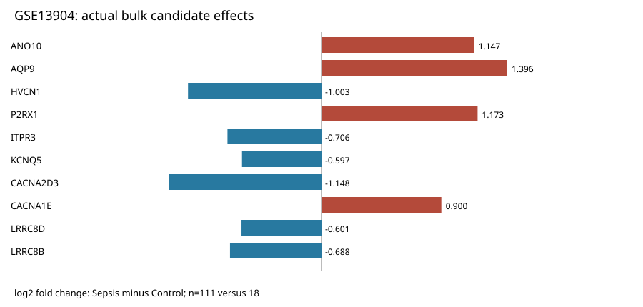
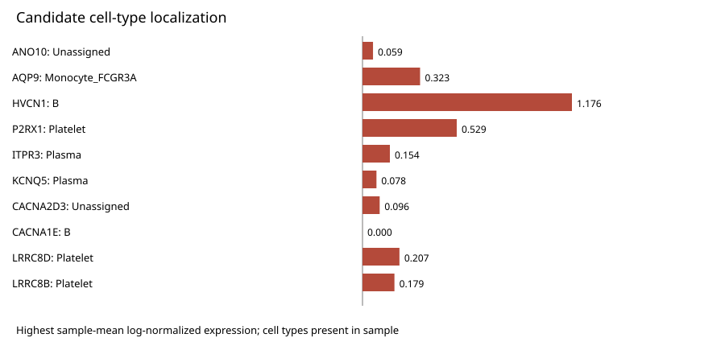

# 儿童脓毒症联合分析：从转录组重点候选到单细胞定位

**儿童脓毒症的转录组变化中，哪些离子通道相关基因值得重点关注，它们主要在哪些细胞群中表达？** 甲、乙、丙三个研究角色通过 SciForge 分工协作，将 129 个 bulk 样本的候选发现与 21 个样本的单细胞定位连接起来，形成一份可沿着结果表和图阅读的联合报告。

本轮从原始 CEL 完成 RMA 与 limma，发现 **3,312 个差异基因，其中 22 个为显著差异的 HGNC 离子通道相关基因**，进一步筛选出 ANO10、AQP9、HVCN1、P2RX1 等 **10 个重点候选基因**。单细胞分析保留 **137,233 个细胞**，形成 32 簇、11 类标签，将重点候选连接到 110 条候选×细胞类型记录和 11 类比例结果。AQP9 的最高平均表达群为 FCGR3A 单核细胞，HVCN1 为 B 细胞，P2RX1 为血小板，为 bulk 变化补充了具体的细胞群背景。

**六项任务于 2026-11-13 13:24（Asia/Shanghai）全部完成提交与负责人采纳，项目达到 6/6。** SciForge 将这段研究过程组织为任务分配、材料交接、具体审阅与返修、结果提交和负责人采纳，让每个角色的产物成为下一步可直接使用的输入。

[阅读联合分析报告](./outputs/REPORT.md) · [查看协作与交付记录](./provenance/collaboration.md) · [浏览重点候选联合摘要](./outputs/tables/joint_candidate_summary.csv)

## 从重点候选到细胞群



| 研究环节 | 实际成果 | 进入下一步的材料 |
| --- | --- | --- |
| 甲：bulk 发现 | 129 个样本（111 病例、18 对照）；从原始 CEL 完成 RMA 与基因层 limma，测量 20,823 个基因 | 3,312 个差异基因、22 个显著离子通道相关基因及 10 个重点候选基因 |
| 乙：单细胞分析 | 21 个样本（17 PS、4 PHC）；156,971 个输入细胞，保留 137,233 个细胞、25,246 个基因，形成 32 簇、11 类标签 | QC 与注释结果、重点候选表达定位及样本级统计 |
| 丙：联合报告 | 汇合甲的 bulk 效应与乙的细胞类型结果，整理全部 110 条表达记录和 11 类比例结果 | 联合报告、结果表、图及完整本地产物索引 |

10 个重点候选基因为 **ANO10、AQP9、HVCN1、P2RX1、ITPR3、KCNQ5、CACNA2D3、CACNA1E、LRRC8D、LRRC8B**。除上述定位外，ITPR3、KCNQ5 的最高平均表达群为浆细胞，LRRC8D、LRRC8B 为血小板；各基因的表达均值、检出率和组间结果见[联合摘要](./outputs/tables/joint_candidate_summary.csv)。



## 三个研究角色如何完成协作

1. **任务分配。** 甲承担 bulk 分析与负责人采纳，乙承担单细胞分析和候选定位，丙承担交接审阅与联合报告。六项任务覆盖输入契约、契约审阅、bulk 分析、单细胞注释、候选证据和最终整合。
2. **材料交接。** 乙先提交输入契约与检查工具；甲的实际重点候选表随后交给乙作为定位输入；乙再将轻量统计表交给丙，衔接两种数据层次。
3. **具体审阅与返修。** 丙在输入契约审阅中提出 R04、R05：明确拒收重复坐标，并补足与下载文件名、工作目录无关的执行命令。乙修订为 1.0.1，补充正反例与实际运行记录；丙复测后接受。这个返修实例发生在输入契约阶段，详见[协作记录](./provenance/collaboration.md)。
4. **结果提交。** 甲提交实际 bulk 分析与重点候选，乙分别提交单细胞注释和候选证据，丙提交联合报告。云端小型摘要 ZIP 承载结果与索引，完整统计、对象、代码和图保留在本地产物目录。
5. **负责人采纳。** 甲对确定版本逐项采纳，推进依赖任务，最终六项交付全部完成。
6. **联合报告。** 丙将重点候选的 bulk 方向、细胞群定位、表达与比例结果汇入同一份报告，读者可以从单个基因追到对应统计表和图。

## 结果与图表

- [联合分析报告](./outputs/REPORT.md)：研究结果、10 个重点候选基因及细胞群背景。
- [重点候选 bulk 统计](./outputs/tables/candidate_bulk_summary.csv)与[联合摘要](./outputs/tables/joint_candidate_summary.csv)：从 bulk 效应连接到细胞类型。
- [全部 110 条表达记录](./outputs/tables/joint_gene_celltype_results.csv)与[11 类比例结果](./outputs/tables/celltype_proportion_results.csv)：保留完整数值。
- [细胞比例差值图](./outputs/figures/celltype_proportion_difference.svg)：对比 PS 与 PHC 的平均比例。
- [任务提交与采纳记录](./provenance/collaboration.md)：六项任务的时间线与 R04/R05 返修实例。

## 仓库结构与验证

```text
sciforge-sepsis-bulk-singlecell/
├── README.md                     # 研究问题、成果与协作过程
├── outputs/
│   ├── REPORT.md                 # 联合分析报告
│   ├── tables/                   # 4 张实际结果 CSV
│   └── figures/                  # 3 幅实际结果 SVG
├── provenance/
│   └── collaboration.md          # 交接、R04/R05 返修与六项采纳记录
└── scripts/
    └── verify_results.py         # 结果数量与本地链接检查
```

在仓库根目录运行（仅需 Python 3 标准库）：

```bash
python3 scripts/verify_results.py
```

预期结果为 10/10/110/11 条表格记录、90 条有效表达 FDR、20 条 NA，以及 SVG 和本地链接检查通过。此入口核对发布材料，不重新运行完整分析。

## 案例范围与数据来源

甲、乙、丙三个研究角色由同一操作者驱动的 AI 模拟，评价聚焦实际产物与协作任务完成。本轮重点候选采用差异排序，未包含原方案的 LASSO、稳定性分析和 GSE26378 跨队列评估；单细胞采用样本级统计，110 条表达记录中 90 条具有有效 FDR、20 条为 NA，有效表达及比例比较均无 FDR<0.05，因此细胞定位按描述性结果呈现。统计细节集中在[结果说明](./outputs/REPORT.md#分析范围与统计说明)。

数据来自 GEO [GSE13904](https://www.ncbi.nlm.nih.gov/geo/query/acc.cgi?acc=GSE13904) 与 [GSE279452](https://www.ncbi.nlm.nih.gov/geo/query/acc.cgi?acc=GSE279452)，原始数据使用条件以来源说明为准。本目录提供案例正文、实际汇总 CSV 和 SVG；完整输入、分析对象与复跑代码未随附，界面原始截图保留本地，未纳入此目录。
