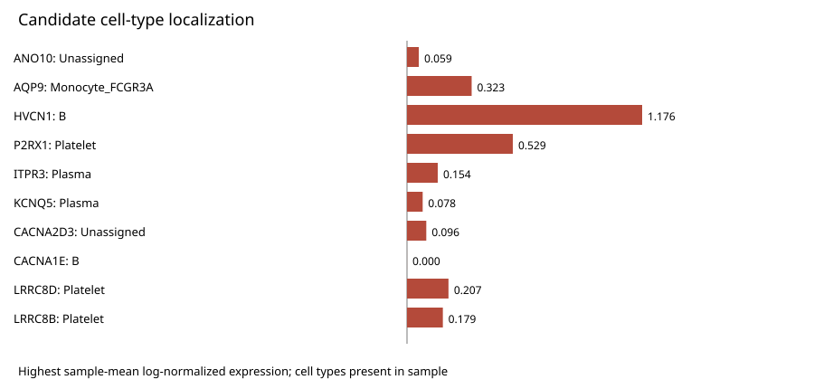

# 转录组与单细胞：重点候选基因与细胞群的联合结果

甲、乙、丙三个研究角色将 bulk 候选发现、单细胞表达定位与联合报告接续起来：从 129 个样本的原始 CEL 中发现 3,312 个差异基因，其中 22 个为显著差异的 HGNC 离子通道相关基因，筛选出 10 个重点候选基因；再用 21 个样本、137,233 个保留细胞为这些基因补充细胞群背景。六项任务于 **2026-11-13 13:24（Asia/Shanghai）** 全部完成提交与负责人采纳，过程见[协作与交付记录](../provenance/collaboration.md)。

本说明文档以 Group_A、Group_B 表示两组，所有差值方向保持为 Group_A−Group_B；两类分析的输入分别处理，组名不代表样本一一配对。本说明省略输入来源与原始身份信息；配套 CSV、图表和分析代码保留原始标注与数值。

## 甲：从原始 CEL 形成 10 个重点候选基因

甲对转录组输入数据完成 RMA 和基因层 limma，纳入 129 个样本（111 Group_A、18 Group_B），测量 54,675 个探针、20,823 个基因。以 BH FDR<0.05 且 |log2FC|≥0.5 为差异阈值，得到 **3,312 个差异基因**。HGNC 离子通道参考集包含 332 个基因，其中 314 个被测得，**22 个满足显著差异阈值**。

在这 22 个基因中按 BH FDR、再按绝对效应排序取前 10 个重点候选基因：ANO10、AQP9、HVCN1、P2RX1、ITPR3、KCNQ5、CACNA2D3、CACNA1E、LRRC8D、LRRC8B。4 个上调、6 个下调，表中方向均为 Group_A−Group_B。

|重点候选基因|log2FC|BH FDR|方向|
|---|---:|---:|---|
|ANO10|1.1471|1.6e-13|up_in_Group_A|
|AQP9|1.3958|2.6e-10|up_in_Group_A|
|HVCN1|-1.0029|7.977e-09|down_in_Group_A|
|P2RX1|1.1726|1.75e-08|up_in_Group_A|
|ITPR3|-0.7065|2.207e-08|down_in_Group_A|
|KCNQ5|-0.5973|1.159e-06|down_in_Group_A|
|CACNA2D3|-1.1481|2.183e-06|down_in_Group_A|
|CACNA1E|0.9002|2.252e-06|up_in_Group_A|
|LRRC8D|-0.6011|3.053e-06|down_in_Group_A|
|LRRC8B|-0.6875|1.352e-05|down_in_Group_A|

[查看 10 个重点候选基因的 bulk 效应图](./figures/bulk_candidate_logFC.svg)

唯一 symbol 探针中取平均 RMA 最高者，每基因重拟合 limma，并在全部测量基因上做 BH 校正。完整数值见[重点候选 bulk 表](./tables/candidate_bulk_summary.csv)。

## 乙：用 137,233 个细胞定位重点候选基因

乙完成 21 个样本（17 Group_A、4 Group_B）的 QC、降维、聚类和多 marker 注释。从 156,971 个输入细胞中，经基础 QC 保留 148,646 个，去除 11,413 个预测 doublet，最终保留 **137,233 个细胞、25,246 个基因**，形成 **32 簇、11 类标签**。

甲交来的 10 个重点候选基因均存在于单细胞矩阵中。乙按样本×细胞类型计算平均 log 表达与检出比例，样本等权汇总，形成 **110 条候选×细胞类型记录**。下表呈现各基因最高平均表达群及对应的组间结果；Unassigned 为未赋予明确细胞类型的群体。

|重点候选基因|最高表达细胞类型|平均log表达|检出率(%)|Group_A均值|Group_B均值|Group_A/Group_B样本数|Group_A−Group_B表达差|表达FDR|
|---|---|---:|---:|---:|---:|---|---:|---:|
|ANO10|Unassigned|0.05905|8.293|0.05299|0.07876|13/4|-0.02578|0.946|
|AQP9|Monocyte_FCGR3A|0.3234|29.34|0.4065|0.05343|13/4|0.353|0.2854|
|HVCN1|B|1.176|64.54|1.128|1.381|17/4|-0.2529|0.5267|
|P2RX1|Platelet|0.5293|23.42|0.5694|0.369|16/4|0.2003|0.5267|
|ITPR3|Plasma|0.1538|27.13|0.1724|0.08393|15/4|0.08848|0.5267|
|KCNQ5|Plasma|0.07839|15.71|0.07515|0.09054|15/4|-0.01539|0.9843|
|CACNA2D3|Unassigned|0.09648|11.91|0.06481|0.1994|13/4|-0.1346|0.3322|
|CACNA1E|B|0.0001648|0.01839|0.0002036|0|17/4|0.0002036|0.7344|
|LRRC8D|Platelet|0.2075|10.07|0.2165|0.1712|16/4|0.04539|0.9843|
|LRRC8B|Platelet|0.1794|7.98|0.1897|0.1384|16/4|0.05128|0.9843|

可从这张表快速连接两层数据：**AQP9** 的 bulk log2FC 为 1.3958，其最高表达群为 FCGR3A 单核细胞，平均 log 表达 0.3234、检出率 29.34%；**HVCN1** 的最高表达群为 B 细胞，检出率 64.54%；**P2RX1** 为血小板，检出率 23.42%。ITPR3、KCNQ5 主要定位于浆细胞，LRRC8D、LRRC8B 则为血小板。ANO10、CACNA2D3 的最高表达群保留为 Unassigned；CACNA1E 在矩阵中存在，但平均表达及检出率较低。

全部细胞群的表达、检出率和组间数值见[110 条联合记录](./tables/joint_gene_celltype_results.csv)，每个基因的跨层摘要见[重点候选联合表](./tables/joint_candidate_summary.csv)。

## 丙：把候选定位与细胞比例汇成联合报告

丙接收甲的实际重点候选与 bulk 效应，以及乙的表达定位、组间统计和比例表，将它们合并为同一套结果，读者可以沿着“bulk 变化 → 细胞群 → 样本级表达与比例”阅读每个重点候选基因。

在 11 类标签中，按 Group_A−Group_B 平均比例差绝对值排序，变化最大的三类为：

- **B 细胞**：Group_A 29.25%、Group_B 11.11%，差值 +18.14 个百分点。
- **T_CD8**：Group_A 16.13%、Group_B 22.58%，差值 −6.45 个百分点。
- **浆细胞**：Group_A 2.57%、Group_B 8.77%，差值 −6.19 个百分点。

|细胞类型|Group_A均值|Group_B均值|Group_A−Group_B|FDR|
|---|---:|---:|---:|---:|
|B|0.292489034910444|0.111133616771746|0.181355418138697|0.36315793519291|
|Erythroid|0.023364315828803|0.00135422592424424|0.0220100899045587|0.746364545910954|
|Monocyte_CD14|0.093765825047532|0.129947053749673|-0.036181228702141|0.482010989553494|
|Monocyte_FCGR3A|0.0408192366201645|0.00964265687712015|0.0311765797430444|0.892784524036517|
|Neutrophil|0.0140400237866083|0|0.0140400237866083|0.36315793519291|
|NK|0.0525697894729155|0.0902188946982586|-0.0376491052253431|0.36315793519291|
|Plasma|0.025723126344958|0.0876629870126542|-0.0619398606676961|0.746364545910954|
|Platelet|0.029735470159987|0.021319680628675|0.00841578953131198|0.689925669082813|
|T_CD4|0.263097399055355|0.313646040691466|-0.0505486416361111|0.689925669082813|
|T_CD8|0.161336323893454|0.225816192570973|-0.0644798686775198|0.36315793519291|
|Unassigned|0.00305945487977946|0.00925865107518902|-0.00619919619540956|0.36315793519291|

[查看细胞比例差图](./figures/celltype_proportion_difference.svg)

完整比例数值见[细胞比例表](./tables/celltype_proportion_results.csv)。本轮交付把 10 个重点候选基因逐一连接到具体细胞群与对应统计，并将三个研究角色的分析成果汇入可交接的联合报告。

## 分析范围与统计说明

本轮重点候选采用差异排序，未包含原方案的 LASSO、稳定性分析和跨队列评估。单细胞采用样本级统计：表达比较使用存在该细胞类型的样本，比例以每样本保留细胞为分母并包含零组合，使用 Wilcoxon 检验和 BH 校正。110 条表达记录中 **90 条具有有效 FDR，20 条为 NA**；90 条有效表达比较与 11 类比例比较均无 FDR<0.05，最高表达细胞群和组间差值按描述性结果呈现。

原始分析报告生成于 2026-11-13 13:09，本页保留其实际数值并整理最终交付状态。云端以小型摘要 ZIP 传递结果和完整本地产物索引，完整输入、分析对象与复跑代码未随此目录发布。六项任务于 13:24 完成采纳，详见[协作记录](../provenance/collaboration.md)；角色与公开范围说明见[案例入口](../README.md#案例说明)。
